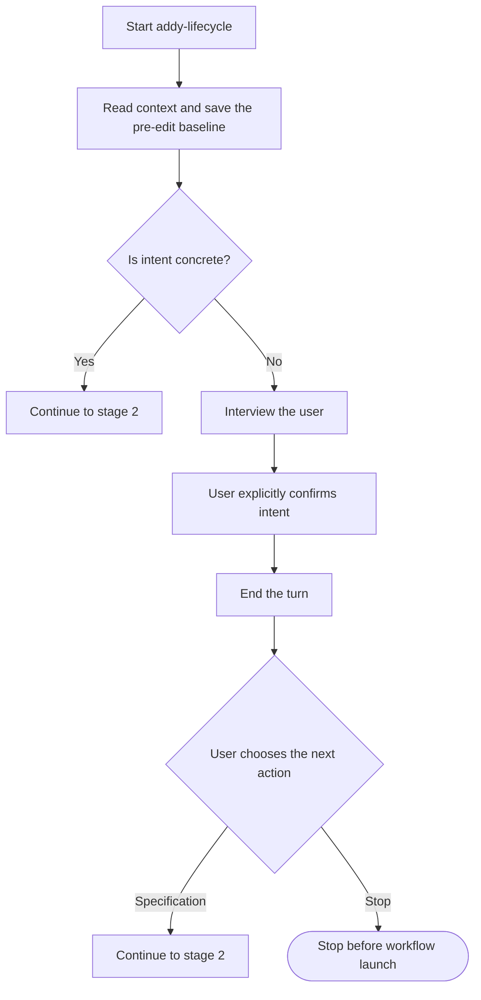
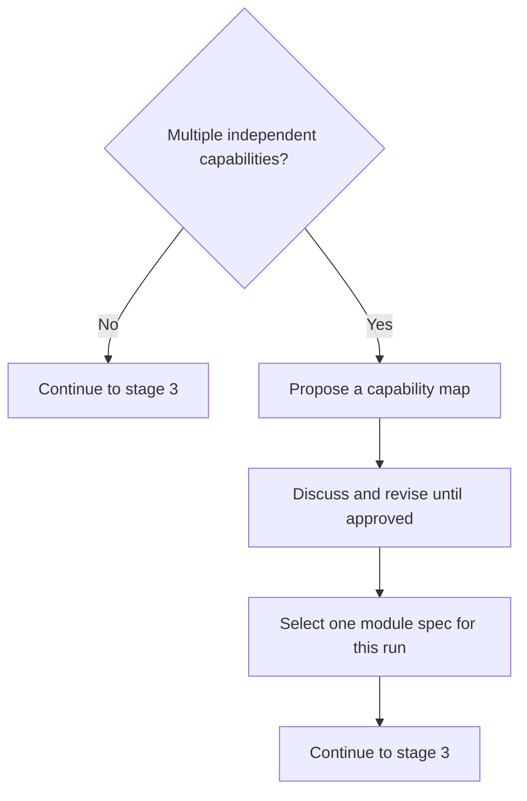
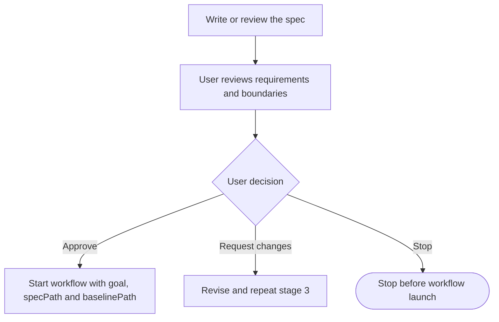
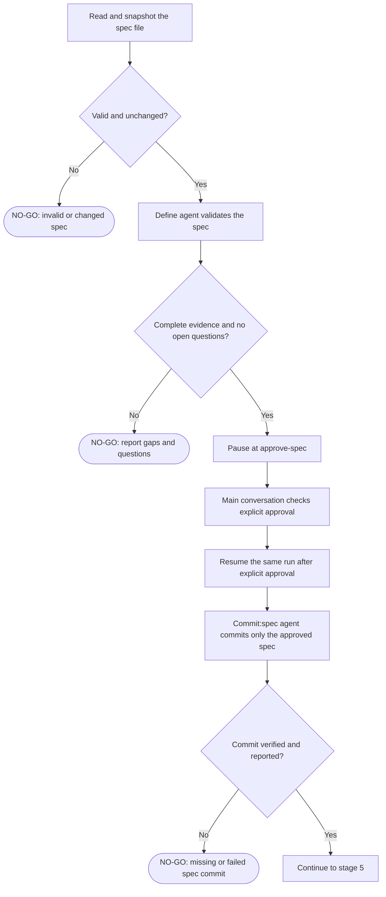
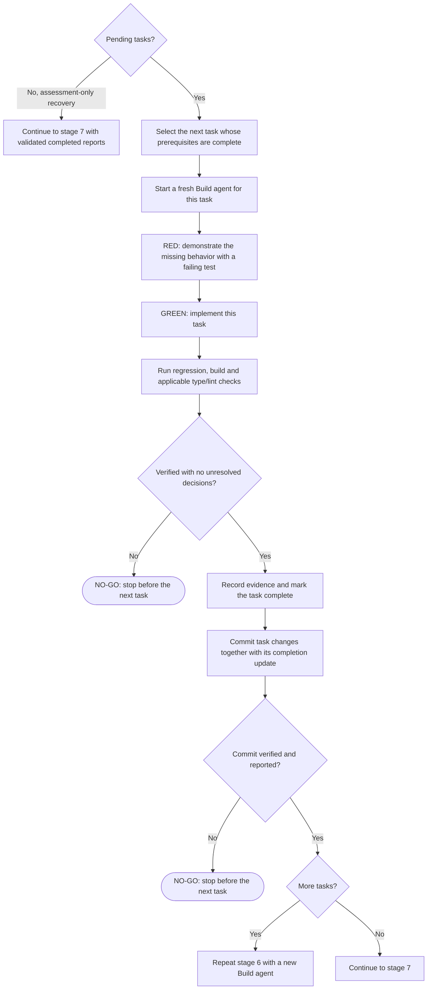
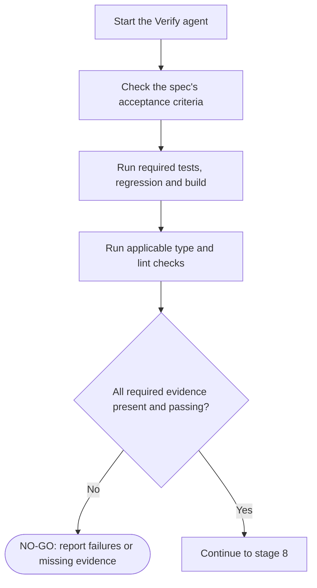
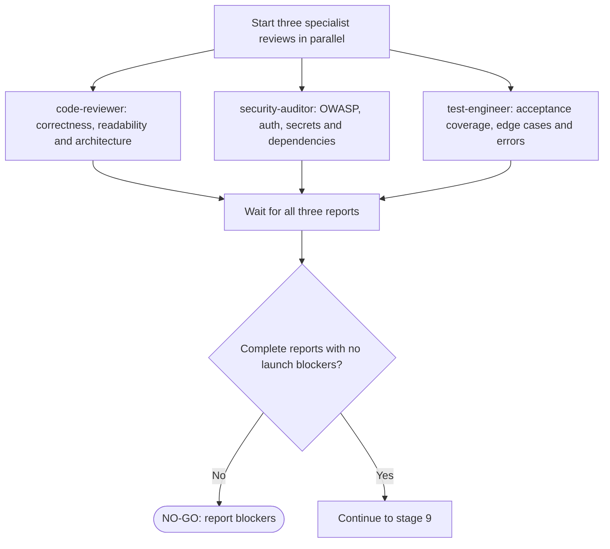
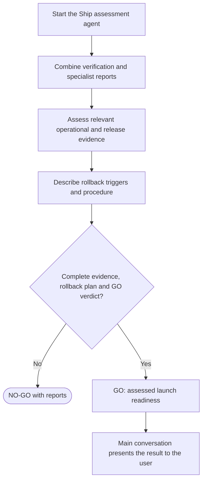
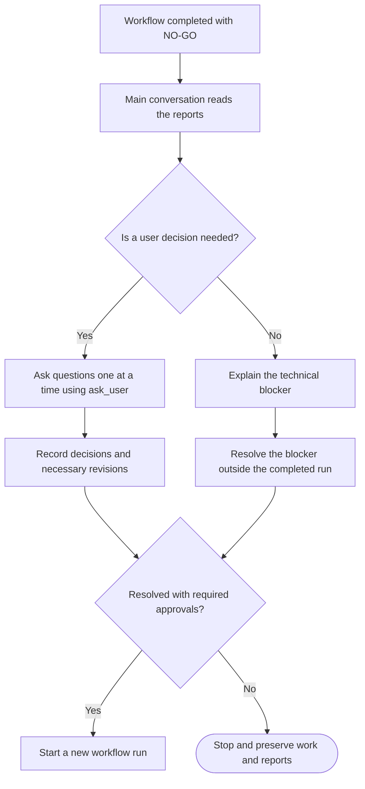

# Personal Copilot plugin

`oskar-tools` is a personal [Agent Plugins 1.0](https://docs.github.com/en/copilot/how-tos/copilot-cli/customize-copilot/plugins-creating) plugin, distributed through the `oskar-personal` marketplace in this repository.

The plugin ships a [git conventions skill and validation hook](#git-conventions) for commit messages, PR titles, and branch names, a [README conventions skill](#readme-conventions) for maintained documentation, [engineering workflow commands](#engineering-workflow-commands) that use the separately installed Addy agent-skills plugin, four [specialist personas](#agents), and [dynamic workflows](#dynamic-workflows) for an engineering lifecycle, batched exhaustive tasks and a no-agent `hello-world` example. These components are available through plugin installation without development mappings. It contains no standalone instructions or MCP servers yet. A `.gitkeep` file only keeps an otherwise empty directory in Git; it is not a Copilot component.

## Git conventions

The rules live in `skills\git-conventions\SKILL.md`. The skill is available globally through user-level plugin installation or the [global skills mapping](#global-development-mappings-on-windows). Its name and description let agents discover it before creating branches, writing commits or PRs, or merging PRs. Full instructions load when the skill is activated, not at session or subagent startup. You can also invoke `git-conventions` explicitly.

- **Commit messages and PR titles:** `<type>(<optional scope>): <Capitalized description>`, where type is one of `feat`, `fix`, `perf`, `docs`, `style`, `refactor`, `test`, or `build`. The first line is at most 72 characters.
- **Language and tone:** English, plain and concise (based on [`bro`](https://github.com/cursor/plugins/tree/main/pstack/skills/bro)). Messages containing `åäöæø` are rejected as a heuristic for non-English text.
- **Branches:** `feature/<kebab-case>` or `release/<name>`.

Skill activation depends on the agent or an explicit request. Independently, a `preToolUse` hook denies tool calls that break the checkable rules. It checks:

- `git commit` (`-m`, `--message`, `-F`, heredocs, and PowerShell here-strings), and branch creation via `git checkout`, `git switch`, `git branch`, and `git worktree add`, in bash and PowerShell tool calls.
- `gh pr create`, `gh pr edit`, and `gh pr merge` (GitHub and GHE), and `az repos pr create` and `az repos pr update` (Azure DevOps).
- GitHub and Azure DevOps MCP tools that create or update pull requests or create branches.

The hook loads through plugin installation or the global `hooks` mapping. Its commands resolve the validator from `${PLUGIN_ROOT}` when loaded as a plugin, and from the user-level hooks directory otherwise. Validation does not depend on skill activation.

The hook only affects agent tool calls, not commands you run yourself. Messages that cannot be resolved statically, such as `$variable` values, are allowed. `fixup!`, `squash!`, and `amend!` commits are skipped. The script requires PowerShell 7 (`pwsh`) on `PATH`. If the validator fails internally, it allows the call.

Run the tests with:

```powershell
pwsh -NoProfile -File tests\git-conventions-hooks.tests.ps1
```

## README conventions

`skills\readme-conventions\SKILL.md` applies when creating or editing a file named `README.md` in any directory, and follows each README's existing language and concise style. It treats README files as maintained references: descriptions must match current code and configuration, claims need evidence, and operational procedures must remain useful beyond a particular change. Session summaries, task status and one-time rollout or migration instructions belong elsewhere; change-specific rollout details and cross-PR dependencies belong in PR descriptions.

The skill's name and description let agents discover it for README work, including documentation updates prompted by code or configuration changes. Its full instructions load when the skill is activated, rather than through session or subagent startup hooks. You can also invoke `readme-conventions` explicitly. Activation depends on the agent or an explicit request; it is not enforced by a file-matching loader, and no hook blocks README edits based on their content.

Plugin installation needs no global directory mappings. For local development, the [global skills mapping](#global-development-mappings-on-windows) exposes the same skill without copying it; the `hooks` and `instructions` mappings are not needed for README conventions.

## Engineering workflow commands

`com.github.copilot\commands\*.md` contains nine Copilot CLI command adapters based on the `.claude\commands` files shipped with [addyosmani/agent-skills](https://github.com/addyosmani/agent-skills), version `0.6.14`, plus a local `addy-lifecycle` command that invokes the coordinator skill of the same name. `com.github.copilot\commands\LICENSE` retains the unchanged upstream MIT license and copyright notice, with a separate attribution clarification. That notice identifies the upstream material; the Copilot adaptations and additional workflow changes belong to this repository's history and are not attributed to or endorsed by Addy Osmani.

The commands use skills from the separately installed, enabled `agent-skills` plugin; they do not bundle or install those skills. If a required skill is unavailable, the command reports the missing dependency and stops. Install the dependency if needed:

```powershell
copilot plugin marketplace add addyosmani/agent-skills
copilot plugin install agent-skills@addy-agent-skills
copilot skill list
```

Copilot registers plugin commands with the plugin name as a prefix. Use the full names below; bare `/plan` and `/review` remain Copilot's built-in commands.

| Command | Workflow |
| --- | --- |
| `/oskar-tools:spec <feature>` | Clarify requirements and write a spec using `spec-driven-development`. |
| `/oskar-tools:addy-lifecycle <feature or spec>` | Invoke the `addy-lifecycle` skill to prepare requirements, collect plan feedback and coordinate the dynamic workflow and its approval gates. |
| `/oskar-tools:plan <scope>` | Break the spec into tasks using `planning-and-task-breakdown`; no implementation. |
| `/oskar-tools:build [auto\|all]` | Implement the next task, or the approved whole plan, using `incremental-implementation` and `test-driven-development`. |
| `/oskar-tools:test <feature or bug>` | Run TDD or the Prove-It bug-fix workflow using `test-driven-development`. |
| `/oskar-tools:review <scope>` | Review changes across five axes using `code-review-and-quality`; no edits or GitHub posting. |
| `/oskar-tools:code-simplify <scope>` | Simplify changed code without changing behavior using `code-simplification`. |
| `/oskar-tools:constraints [check\|guard\|ratchet]` | Set up or operate the quality bar using `constraint-driven-development`. |
| `/oskar-tools:webperf <URL, report, or scope>` | Audit browser-facing performance using `performance-optimization`; distinguish measured Deep mode from unmeasured Quick mode. |
| `/oskar-tools:ship <scope>` | Assess launch readiness using `shipping-and-launch`; produce specialist findings, a GO/NO-GO decision, and a rollback plan, not a deployment. |

Arguments follow the command in chat. `/oskar-tools:build` includes a commit after each verified task; `build auto` also commits newly generated planning documents separately after plan approval. `/oskar-tools:spec` follows the upstream skill's instruction to commit the spec. `/oskar-tools:addy-lifecycle` commits the approved spec, approved plan/task artifacts, and each verified task separately. These workflows do not switch Copilot's runtime mode or bypass tool permissions and repository instructions. Commits do not authorize pushing, merging, or deploying.

The adapters use Copilot instruction sources, installed skill names, and available question/delegation tools rather than Claude-specific frontmatter, instruction paths, or agent APIs. `ship` uses three independent specialist subagents when supported, preferring this plugin's code, security and test personas. `webperf` prefers this plugin's performance persona. The commands can use available general-purpose subagents if custom personas are unavailable; if delegation is unavailable, they explicitly label a direct single-context assessment. Addy's separately installed plugin supplies skills; this plugin supplies the Copilot persona definitions. Live browser checks require suitable configured tools, such as Chrome DevTools MCP, and unavailable measurement evidence is reported rather than invented.

Commands load through plugin installation or a session-scoped `--plugin-dir` mount; the global development mappings below do not expose them. Choose plugin loading instead of mappings for the complete component set, avoiding duplicate hook sources. Command loading and argument forwarding are verified in Copilot CLI; other Copilot clients can have different component support.

Run the command checks with:

```powershell
pwsh -NoProfile -File tests\commands.tests.ps1
pwsh -NoProfile -File tests\commands.tests.ps1 -Runtime
```

The first command checks command/persona packaging, descriptions, skill dependencies, and incompatible runtime assumptions. `-Runtime` also requires an installed Copilot CLI: it installs this plugin into a temporary isolated `COPILOT_HOME` and checks actual namespaced command and persona registration through ACP, without executing a model prompt. It restores the environment and removes the temporary installation.

The `Tests` GitHub Actions workflow runs both test scripts on Windows for pull requests, pushes to `master`, and manual runs. It installs a pinned Copilot CLI and uses a local-provider configuration for discovery-only runtime checks, without Copilot credentials or model requests.

## Install

Use a current GitHub Copilot CLI with Agent Plugins 1.0 support. Once these files are merged into the repository's default branch:

```powershell
copilot plugin marketplace add OskarKlintrot/skills
copilot plugin marketplace browse oskar-personal
copilot plugin install oskar-tools@oskar-personal
copilot plugin list
```

Installation registers the marketplace and installs the plugin in your user-level Copilot configuration. It does not enable automatic updates for this marketplace.

### Optional automatic updates

You can opt in during installation or later. In your user-level `%USERPROFILE%\.copilot\settings.json`, find `extraKnownMarketplaces` and its `oskar-personal` entry, then add:

```json
"autoUpdate": true
```

This is a property to add to the existing marketplace entry, not a complete settings file. Preserve its source information and all other settings. If `COPILOT_HOME` is set, use `settings.json` in that directory instead.

Copilot CLI 1.0.101-0 has no automatic-update flag for `plugin install` or `plugin marketplace add`. The plugin cannot enable this user setting itself. See the [configuration reference](https://docs.github.com/en/copilot/reference/copilot-cli-reference/cli-config-dir-reference#configuration-file-settings) for `extraKnownMarketplaces`.

The opt-in updates the marketplace's installed plugins at session start in interactive CLI and `-p` sessions, subject to CLI update settings, policies, and trust requirements. It does not apply to SDK or server sessions. Automatic updates in the Copilot desktop app are not guaranteed. Repository-level settings cannot enable this marketplace's automatic updates.

## Update

To update manually:

```powershell
copilot plugin marketplace update oskar-personal
copilot plugin update oskar-tools
```

The first command refreshes the marketplace catalog; the second updates the installed plugin. Start a new session to use updated content.

When publishing content changes, increment `version` in `plugin.json` and merge the changes into the branch used by the marketplace. The marketplace entry deliberately omits a duplicate plugin version.

We follow [Semantic Versioning](https://semver.org/): after `1.0.0`, increment the major version for breaking changes, the minor version for backward-compatible additions, and the patch version for backward-compatible bug fixes. During `0.x` development, compatibility is not guaranteed; use minor versions for additions or breaking changes and patch versions for backward-compatible fixes.

## Develop locally

The recommended local workflow is to register this clone as a marketplace. From the repository root:

```powershell
copilot plugin marketplace add .
copilot plugin marketplace browse oskar-personal
copilot plugin install oskar-tools@oskar-personal
copilot plugin list
```

Use either the local or GitHub marketplace source for `oskar-personal`, not both at once. Path-sourced plugins in a local directory marketplace load live from their source directory; restart or start a new session after edits rather than running `plugin update`.

For a direct local installation instead, use the absolute path:

```powershell
copilot plugin install (Get-Location).Path
```

Direct local installations are cached. Run that install command again after changes, then start a new session. CLI 1.0.101-0 rejects a bare `.` for direct installation and warns that direct installs are deprecated; prefer the marketplace workflow.

### Global development mappings on Windows

As an alternative to loading the plugin, directory junctions can expose the working clone as personal CLI customizations. They are explicit local setup, not something plugin installation creates. Use a stable clone, not a temporary session worktree or an installed-plugin cache.

For a clone at `C:\repos\external\OskarKlintrot\skills`, use these mappings:

| Global directory under `%USERPROFILE%\.copilot` | Source relative to the clone |
| --- | --- |
| `skills` | `skills` |
| `agents` | `com.github.copilot\agents` |
| `hooks` | `com.github.copilot\hooks` |
| `instructions` | `instructions` |

If `COPILOT_HOME` is set, its directory replaces `%USERPROFILE%\.copilot`. The root `instructions` directory is for this local mapping only; it is not a portable plugin component.

Use this fail-fast, idempotent setup procedure:

1. Pull the merged changes, or integrate the reviewed local commit, into the stable clone first. Confirm all four source directories exist. Stop on a missing source; do not create an empty substitute or map a cache directory.
2. Inspect every destination before changing anything. An existing junction to the exact intended source is already correct: leave it unchanged. Compare resolved absolute targets, ignoring Windows path casing and trailing separators.
3. Stop on any conflicting destination: a regular file or directory, a symbolic link, or a junction to a different or missing target. Preserve it and resolve the conflict explicitly. Never delete, overwrite, or move existing customizations automatically.
4. After all preflight checks pass, create junctions only for missing destinations, using PowerShell `New-Item -ItemType Junction` with explicit absolute paths. Check each result and surface any error; rerunning the procedure must preserve all correct existing mappings.
5. Leave the existing global `copilot-instructions.md` file untouched. It is a separate instruction source, not the destination of the `instructions` mapping. Preserve unrelated settings and customizations.

Edits through a junction change files in the clone. Add actual content there deliberately; empty mapped directories still provide no capabilities. Global hook mappings also execute future hook definitions locally, so review any hook change before starting a new session.

### Reload and duplicate sources

When using global mappings, keep `oskar-tools@oskar-personal` disabled:

```powershell
copilot plugin disable oskar-tools@oskar-personal
copilot plugin list
```

Also avoid mounting the same plugin with `--plugin-dir` or keeping an enabled direct installation alongside the mappings. Inspect `plugin list` for those separate installs. Choose one loading route for skills, agents, and hooks: plugin loading or global mappings. Do not rely on deduplication; duplicate hook sources can execute the same command more than once.

Start a new CLI session after changing mappings or content; use `/restart` where supported. Inspect instruction discovery in the intended working directory:

```powershell
copilot instruction list --json
```

Check the paths and `applyTo` values, not just the presence of a filename. This lists what that CLI process discovers; it is not proof of what an already-running desktop or SDK session has loaded. An existing session can retain its previous state.

## Add content

The plugin lives at the repository root. The marketplace's `source` points to that root.

```text
plugin.json
.github\plugin\marketplace.json
skills\
instructions\
com.github.copilot\
  agents\
  commands\
  extensions\
    hello-world\
      extension.mjs
    addy-lifecycle\
      extension.mjs
      workflow.mjs
    exhaustive-task\
      extension.mjs
      workflow.mjs
  hooks\
    hooks.json
    scripts\
tests\
```

Empty component directories are tracked with `.gitkeep` files. Keep repository content and instructions in English.

### Skills

Create `skills\<skill-name>\SKILL.md`. Each skill must be an immediate subdirectory of `skills` and include YAML frontmatter with `name` and `description`, followed by its instructions.

See [adding agent skills](https://docs.github.com/en/copilot/how-tos/copilot-cli/customize-copilot/add-skills). Add only skills you actually intend to use; this repository does not ship example skills.

### Agents

The four personas in `com.github.copilot\agents` are adapted from [addyosmani/agent-skills](https://github.com/addyosmani/agent-skills), version `0.6.15`. Their MIT license is retained in `com.github.copilot\agents\LICENSE`; Copilot integration changes belong to this repository, not Addy Osmani. Original content is preserved in the initial import commit before local adaptations.

| Copilot agent ID | Role | Used by |
| --- | --- | --- |
| `oskar-tools:code-reviewer` | Five-axis code review | Lifecycle `Review:code`, `/oskar-tools:ship` |
| `oskar-tools:security-auditor` | Security and trust-boundary review | Lifecycle `Review:security`, `/oskar-tools:ship` |
| `oskar-tools:test-engineer` | Test strategy and coverage analysis | Lifecycle `Review:tests`, `/oskar-tools:ship` |
| `oskar-tools:web-performance-auditor` | Sourced web-performance assessment | `/oskar-tools:webperf`, not the lifecycle's global review fan-out |

Personas define the specialist perspective; separately installed `agent-skills:*` skills define the method. Caller scope, read-only assignments and structured workflow schemas take precedence over a persona's default Markdown template. Missing required skills are blockers. The lifecycle selects its three review personas explicitly through `ctx.agent`'s `agent` option, with no silent generic fallback. Other lifecycle steps use ordinary workflow agents. No persona fixes a model, reasoning effort or context tier.

Create `com.github.copilot\agents\<agent-name>.agent.md` with the appropriate frontmatter and instructions.

See [creating custom agents](https://docs.github.com/en/copilot/how-tos/copilot-cli/customize-copilot/create-custom-agents-for-cli). Agent definitions are Copilot-specific; they are not portable Agent Plugins 1.0 components.

### Commands

Create `com.github.copilot\commands\<command-name>.md` with YAML `description` frontmatter followed by the prompt instructions. The CLI registers it as `/oskar-tools:<command-name>`. Do not add a `commands` path field to the Agent Plugins 1.0 manifest; the namespaced directory is its fixed Copilot-specific location.

Keep shared engineering workflows in the upstream skills rather than duplicating them in command adapters. Refer to installed skills by their discovered names, not hardcoded cache paths. Document new dependencies and retain upstream attribution when adapting third-party commands. See the [engineering workflow commands](#engineering-workflow-commands) for loading, arguments, and permission boundaries.

### Dynamic workflows

[Dynamic workflows](https://docs.github.com/en/copilot/how-tos/use-copilot-agents/use-dynamic-workflows) are Copilot extensions. Create `com.github.copilot\extensions\<extension-name>\extension.mjs` that registers workflows with `defineWorkflow` and `joinSession` from `@github/copilot-sdk/extension`. The current docs do not list this location for Agent Plugins 1.0; it matches the plugins bundled with the Copilot app. Do not add an `extensions` path field to `plugin.json`; in Agent Plugins 1.0 that field holds namespaced client data, not paths. Extensions run local code, so review them like hooks.

The `hello-world` workflow spawns no subagents and uses no AI credits. Verified with CLI **1.0.105** after an isolated plugin installation:

```powershell
copilot --experimental workflow run hello-world --args '{"name":"Oskar"}'
```

It returns `{"greeting":"Hello, Oskar!","source":"oskar-tools plugin"}`. In an interactive session, enable experimental features and ask Copilot to run the `hello-world` dynamic workflow.

#### Exhaustive tasks

`exhaustive-task` grinds through a task that agents tend to abandon early, such as "find every Azure DevOps integration", "list every difference between the design and the implementation" or "update packages in every repository under C:\repos, then change X in Program.cs". It automates asking an agent "did you find everything?" until it stops finding things, so cheaper models can handle investigations that otherwise need stronger ones. Each round is a fresh agent that sees the ledger so far:

**Unit rounds (one batch of files or repositories each) -> review rounds with changing search strategies until `quietRounds` consecutive rounds find no new findings, locations or changes -> final read-only verification, which can reject findings and reopen the search.** Rounds that change files are verified and committed; rounds that only record findings cost a single agent call.

Start with `/oskar-tools:exhaustive-task <task>` or invoke the installed `exhaustive-task` skill. `skills\exhaustive-task\SKILL.md` owns preparation: it clarifies goal and acceptance, chooses the mode and ledger location, asks about batch size and an optional round ceiling, and obtains explicit launch approval including local commits. Execution then runs autonomously until completion, a blocker, a runtime limit or a round checkpoint.

Modes:

| Mode | Units | `paths` |
| --- | --- | --- |
| `files` | Tracked and non-ignored untracked files in the current repository, enumerated by Git | Repository-relative files/directories; `["."]` for the whole repository. Run from the worktree root. |
| `repos` | Git repositories found under `paths` (depth 4; skips hidden, `node_modules`, `bin`, `obj`, `dist`, `build` and `packages`) | Absolute directories |
| `search` | None; only review rounds | Optional absolute directories containing the repositories that may change. Defaults to the current directory. |

Code, not an agent, enumerates units and splits them into batches, so every unit is assigned to exactly one round. Each Work report must list exactly its batch as processed. Afterwards review rounds search for missed findings or remaining changes, each with a strategy different from earlier rounds. They record every new finding or location but make at most `batchSize` changes. `search` mode skips the units and is usually the cheapest choice for discovery: with the defaults, one productive round, two quiet rounds and the final verification make four agent calls. Use it when the work cannot be enumerated as files or repositories, for example comparing against a design: export the design to a file first, since workflow agents cannot open canvases.

```powershell
copilot --experimental workflow run exhaustive-task --args '{"goal":"Find every Azure DevOps integration","acceptance":"Each integration lists source locations, purpose, authentication and API used, verified against the source.","mode":"files","paths":["."],"ledgerPath":"C:\\session-artifacts\\ado-integrations.md"}'
```

Arguments: `goal`, `acceptance`, `mode` and an absolute `ledgerPath` are required. Optional `paths` (required for `files` and `repos`), `batchSize` (default 5 files, 1 repository or 5 changes per review round), `quietRounds` (default 2), `maxRounds` (no default), `model` (workers and commits) and `verifyModel` (verification; defaults to `model`). Without models the runtime preferences apply. Direct invocation skips the skill's preparation; the caller must arrange equivalent approval.

The ledger is a workflow-owned Markdown file with findings (stable kebab-case IDs, locations, details), changes, productive review strategies, rejected finding IDs and processed units, plus an embedded JSON state block. Agents return findings; the code merges duplicates by ID and writes the file, so earlier results cannot be lost. Rejected findings are removed and cannot be re-added. Starting a new run with the same `ledgerPath`, goal and mode continues after the processed units; another goal or a non-ledger file is rejected. The `files` manifest excludes the ledger. Keep the ledger outside the repository unless it is a deliverable: a ledger inside a repository changes the files every productive round and so triggers a Commit agent.

When a round changes file contents, the verifier checks its findings and changes and runs relevant non-mutating checks. An incomplete verdict sends its repair instructions back to Work, up to three attempts per round. Findings-only rounds skip this; the final verification instead checks every finding and runs its own searches. An incomplete final verdict starts another review round with its instructions, up to three final verifications. When file contents changed, a Commit agent follows `agent-skills:git-workflow-and-versioning` and saves the round as atomic commits in each changed repository, one per logical change with separate concerns, never on a default or detached branch. The ledger, if it lives there, goes with the commit it documents. The skill offers to create a feature branch for repositories on their default branch and, after a blocked round, asks whether to keep or reverse the uncommitted edits. Files that were dirty before the run are user work: agents must not revert or commit them, and the Commit agent reports changes to them as uncommitted. The code detects content changes with a temporary Git index (`git add -A` + `git write-tree` without touching the real index), blocks if Verify or Commit changes file contents, and requires a commit or an explanation for every changed repository.

Optional `maxRounds` pauses after every that many rounds while work remains. The main conversation must obtain approval before resuming the same run; edits while paused block the resumed round. Blocked results include `reason`, `remainingUnits`, `needsInput` and the ledger path. Resolve the cause and start a new run with the same ledger.

Limitations: findings and coverage are model reports checked for structure, batch coverage and file stability, not proof of semantic completeness. Unit rounds that only record findings are not verified individually, so a worker that skims a batch is caught only if the final verification notices. Review rounds stop when agents stop finding things, not when completeness is proven. The code does not verify that commits exist or are isolated. There is no declared resource ceiling; set runtime limits when needed. Agents share the working tree and run sequentially. No role may push, merge, deploy, reset hard, rewrite history, blindly restore files from another branch or change remote systems.

Run the workflow contract tests without model requests:

```powershell
node --test tests\exhaustive-task.tests.mjs
```

They run a simulated workflow context against real temporary Git repositories: batch coverage, review termination, final verification, model selection, duplicate merging, rejected findings, repairs, commits with pre-existing edits, repository discovery, ledger continuation and round checkpoints. `tests\commands.tests.ps1 -Runtime` checks installed skill/workflow registration. Neither establishes live model compliance.

#### Addy lifecycle

`addy-lifecycle` adapts [Addy's lifecycle](https://skills.addy.ie/) and [`/build auto`](https://github.com/addyosmani/agent-skills/blob/301b02b12bff98e4688e6984af6556802322bbde/.claude/commands/build.md) into one workflow:

**Interactive requirements and spec in the main conversation -> Define (validate spec) -> approve spec -> commit spec -> Plan -> approve plan -> commit plan -> sequential Build/test/commit loop -> Verify -> parallel Review -> Ship decision.**

This is a custom orchestration, not a `/loop` or `/lifecycle` command from the original Addy project. That project's lifecycle is user-driven; its build loop executes an approved finite task set. This adaptation uses the same skill dependencies as the command adapters: `spec-driven-development`, `planning-and-task-breakdown`, `incremental-implementation`, `test-driven-development`, `code-review-and-quality`, `security-and-hardening`, and `shipping-and-launch`, plus `git-workflow-and-versioning` for atomic save points; build failures also require `debugging-and-error-recovery`. Unclear intent also requires `interview-me` during interactive preparation. Missing skills stop the affected phase.

After installing the plugin, start an experimental interactive session and use:

```text
/oskar-tools:addy-lifecycle Describe the feature here
```

The command invokes `skills\addy-lifecycle\SKILL.md`, the single coordinator definition. You can also invoke the installed `oskar-tools:addy-lifecycle` skill directly or ask Copilot to use the `addy-lifecycle` skill. It prepares the spec and starts the `addy-lifecycle` dynamic workflow after user approval; it does not merely describe the lifecycle.

Copilot CLI exposes the skill at `/oskar-tools:addy-lifecycle` when the skill and command adapter share that name; the adapter points to the same coordinator for clients that load it as a command. Both entry paths use the skill's approval and feedback instructions.

The skill keeps `ask_user`, any `interview-me` dialogue, capability-map approval and spec writing in the main conversation. Interview confirmation ends that turn before specification proceeds. The user must approve the actual spec, not just its intent. If no interactive input is available, preparation stops. The workflow never relies on a worker having access to a human-input tool.

Before spec or planning edits, the coordinator records the working-tree and index baseline (`git status --porcelain`, `git diff`, `git diff --cached`, and relevant untracked content) in a session artifact outside committed repository content. It preserves that baseline across revisions and passes its path to every worker. If existing changes cannot be attributed or separated safely, it stops for user guidance rather than absorbing them into a commit.

Direct workflow invocation requires `goal`, `specPath` and `baselinePath`, for example `{"goal":"Add search","specPath":"SPEC.md","baselinePath":"C:\\session-artifacts\\baseline.txt"}`. Supply a real pre-edit baseline artifact and prepare and review the spec with the user first. `specPath` must identify a non-empty file inside the current worktree; missing inputs are rejected before spawning agents. Define validates the existing spec read-only instead of starting another interview. The runtime snapshots its content; edits between attempts stop the run before cached spec approval can be reused. New scope requires a new run.

The workflow consumes AI credits. It does not choose models or impose resource ceilings; use the runtime's run limits when needed. It creates a fresh agent context per phase, preparatory commit, or build task. Build tasks share the worktree and run sequentially in validated dependency order; only the three read-only specialist reviews run in parallel. Each task follows RED -> GREEN -> regression -> build/type/lint checks -> record completion -> commit before the next task.

The workflow pauses durably at `approve-spec` and `approve-plan`, logging the artifact reports and run ID. The main conversation reviews the files and obtains explicit approval before resuming the exact run; an earlier explicit approval can cover the same unchanged spec. The runtime checkpoint itself is a resume signal, not a user-approval dialog. Pausing or a worker's claim of approval is not authorization. Do not edit the approved scope and resume stale output: start a new run for revisions. After plan approval, all tasks run without between-task approval, but agents must stop for ambiguity, conflicting user edits, new high-risk decisions, or failed/missing verification.

At `approve-plan`, the coordinator presents the complete plan and asks whether to approve, request changes, or stop. Feedback is discussed in the main conversation and incorporated into the plan/task artifacts before building. A changed plan requires a new run because the old output is journaled; the old run stays paused. The new plan must match the approved revisions, or be presented for explicit approval again. Repeating feedback never authorizes implementation by itself.

All workers are instructed to be non-interactive: no `ask_user`, interviews, nested delegation or waiting for human approval. A decision needed in any phase returns a blocked report with `questions`; the workflow stops with `NO-GO` and aggregates them into `needsInput`, even if the worker incorrectly reports ready. The `addy-lifecycle` skill routes those questions to the user one at a time in the main conversation, records decisions in the relevant artifacts and obtains renewed approval for changed scope. These are agent instructions and report gates, not a sandbox that removes tools from workers.

Plan produces artifacts without waiting internally for its skill's human-review step; `approve-plan` is that gate. Verify uses test guidance for assessment only, without entering TDD implementation or changing snapshots/dependencies. Review consumes Verify evidence without running concurrent builds/tests or applying fixes. Ship uses the existing specialist reports for assessment only, without executing the skill's deployment, feature-flag or rollback procedures. Human decisions in any of these steps are returned to the main conversation rather than delegated to another worker.

The runtime journals agent results across a paused run, so resuming does not re-execute completed phases or tasks. Abrupt interruption during an agent's edits is not a transaction: inspect the worktree and durable task records before recovery. `NO-GO` is a completed assessment result, not a runtime exception or resumable repair loop. Resolve the reported blocker and start a new run; its planning phase must reconcile pending tasks with existing artifacts and current evidence. Runtime cancellation, limit and storage failures propagate to the runtime rather than becoming successful assessments.

Verification and release gates validate structured agent reports, not the underlying truth of model claims. Reports require non-empty evidence; build and integrated verification require actual-command reports with only passing outcomes. Missing specialist reports, Critical/High/Required findings, or a missing rollback plan prevent GO. The ship phase synthesizes the existing code, security and test reviews without another fan-out. Required browser/performance evidence must be reported as unavailable rather than fabricated. A human must still review the evidence before release.

The workflow follows Addy's atomic save-point discipline: approved spec and plan get preparatory commits, then each verified Build task gets a commit including its completion update. Only workflow-owned changes relative to the pre-edit baseline may be committed. Existing user edits and staged entries must be preserved, including edits in the same file; unsafe separation or denied commits stop the run. Workers must not blindly stage everything, commit the whole index, bypass hooks, amend, stash or reset. They inspect already committed approved content before reusing a reachable commit rather than creating duplicate or empty commits.

Spec/plan commit workers and Build workers return a full commit object ID and actual Git verification evidence. The workflow requires a valid-looking full ID, passing checks and no unresolved questions before advancing; workers are responsible for checking reachability, exact committed scope and success in Git. These report gates are not an independent Git verifier. The workflow never authorizes pushes, merges or deployment; `Ship` means launch-readiness assessment only. Source instructions are composed from skill references and this repository's orchestration policy, not bundled copies of upstream skills.

##### End-to-end flow

The diagrams below describe the coordinator skill and workflow together. Each diagram is a separate stage; "continue" and "repeat" boxes name the next action rather than drawing long return arrows across stages. Every `NO-GO` endpoint uses the common recovery flow in stage 10.

The main conversation owns user interaction and records the pre-edit baseline. Each workflow phase and preparatory commit gets a fresh subagent context, and each Build task gets its own subagent. These are not separate project sessions: they share the same worktree, files and index, with no per-task branch or isolated checkout. Tasks run sequentially; only the three read-only Review agents run in parallel. Worker labels identify assignments; the Review calls separately select the three packaged personas listed under [Agents](#agents). The workflow passes no model, reasoning-effort or context-tier overrides; effective selection is left to Copilot's runtime settings and policy, not fixed by this plugin.

###### 1. Understand intent

When intent is unclear, the main conversation uses `interview-me` and asks one question at a time. Explicit intent confirmation ends that turn; it is not permission to write a spec or launch the workflow immediately.



###### 2. Bound the scope

If the request bundles independently testable capabilities, agree on a capability map before writing module specs. Select one concrete module spec per workflow run.



If the user declines to proceed with scope definition, stop without launching a workflow.

###### 3. Prepare and approve the spec

Write or review an actual spec in the worktree, normally `SPEC.md`, never a README. Preserve unrelated specs and unfinished plans. Specification uses only the relevant phase of `spec-driven-development`; it does not start that skill's planning or implementation phases.



Approval of intent does not substitute for approval of the actual spec. Direct workflow invocation skips this conversational preparation, so its caller must arrange the same dialogue and approval first.

###### 4. Validate the existing spec

The workflow requires non-empty `goal`, `specPath` and `baselinePath` arguments. Missing or invalid argument types are rejected; blank values fail before any agent starts. File preflight requires a readable, non-empty spec inside the current worktree. The runtime snapshots its path and contents and checks them again on each resumed attempt. Define validates the spec read-only and returns requirements and evidence, not a rewritten spec.



Resumption requires explicit approval of the exact spec. An earlier approval may cover that same unchanged file. Otherwise ask the user; do not auto-resume. A revised spec requires a new run, and choosing to stop leaves the run paused. `Commit:spec` uses `git-workflow-and-versioning` without changing the spec content; it must return commit verification before Plan starts.

###### 5. Produce the plan and tasks

Plan creates both the plan and task list at repository-standard paths, defaulting to `tasks\plan.md` and `tasks\todo.md`. It also returns a structured pending `tasks` array and a `completed` array in its report. Every task has these fields:

| Field | Meaning |
| --- | --- |
| `id` | Unique kebab-case task identifier. |
| `title` | The thin vertical slice to implement. |
| `acceptance` | Concrete acceptance criteria, including verification instructions. |
| `dependsOn` | Explicit prerequisite task IDs; do not infer dependencies from list order. |

The workflow validates this report and orders tasks by dependencies. **Build consumes the report's pending `tasks` array, not unchecked lines discovered independently in the task file.** The files are durable planning/status artifacts; the journaled report controls this run's execution.

For an initial plan, `completed` is empty. Recovery can carry completed entries shaped as `{ task, report }`, with the full task definition and a ready report containing `summary`, `evidence`, passing `checks`, empty `questions` and a full `commit` ID. Plan must check current acceptance evidence, approved scope, commit reachability and exact scope against Git and durable artifacts, not just trust old checkboxes or reports. As with Build commits, the runtime validates report shape and evidence gates; it does not independently execute the Git checks. Pending tasks may depend on validated completed task IDs. IDs must be unique across both arrays, and completed tasks may depend only on other completed tasks.

```mermaid
flowchart TD
    plan["Plan agent reads the approved spec"] --> files["Write plan and task-list artifacts"]
    files --> report["Return a structured report containing tasks"]
    report --> graph{"Valid graph with pending or verified completed work?"}
    graph -->|No| blocked(["NO-GO: blocked or invalid plan"])
    graph -->|Yes| pause["Pause at approve-plan"]
    pause --> present["Main conversation presents the complete plan"]
    present --> decision{"User decision"}
    decision -->|Approve| commit["Resume and commit the approved plan/task artifacts"]
    decision -->|Request changes| revise["Discuss and revise without building"]
    decision -->|Stop| stop(["Leave the run paused"])
    revise --> restart["Approve the revision, then start a new run"]
    commit --> saved{"Commit verified and reported?"}
    saved -->|No| failed(["NO-GO: missing or failed plan commit"])
    saved -->|Yes| proceed["Continue to stage 6"]
```

Duplicate IDs, missing prerequisites, cycles, invalid completed reports, and a plan with neither pending nor validated completed work stop before the approval checkpoint. Plan itself never waits for a human: `approve-plan` is the workflow's human-review boundary.

After approval, a separate `Commit:plan` agent commits only the approved planning artifacts, without changing their content or implementing tasks. A verified commit is required to continue to stage 6; failure returns NO-GO. This commit is separate from task implementation commits.

Plan feedback can repeat until the user approves. The old run stays paused because its plan report is journaled. In the new run, compare the generated plan with the requested revisions and approved artifacts; any differences require renewed approval before Build. Editing `tasks\todo.md` alone does not replace the old run's task array. A new run repeats preflight, Define and Plan; there is no plan-only revision entry point.

###### 6. Build one task at a time

The workflow visits the approved finite task set in dependency order. A fresh Build agent receives exactly one task, the spec and plan reports, and completed-task reports. It does not implement the rest of the plan.



Within its assignment, the agent may diagnose and fix a failed check using `debugging-and-error-recovery`. Unresolved failure, a missing skill, conflicting user work or a new decision blocks the task; there is no unbounded retry loop. Task status is recorded only after verification and included in that task's atomic commit. Missing, denied or unverified commits stop the loop before another task starts. Approval runs the whole task set without between-task human checkpoints, but never authorizes new high-risk decisions.

###### 7. Verify the integrated change

Verify uses a separate context to assess the entire change against the spec and plan. Passing per-task checks do not replace this integrated check.



Verify does not fix source, install dependencies, update snapshots or use auto-fix commands. A required write or permission decision is returned to the main conversation.

###### 8. Review in parallel

Three independent subagents use the packaged `code-reviewer`, `security-auditor` and `test-engineer` personas to read the committed change and Verify evidence. They return the workflow's structured schema rather than their default Markdown templates. They do not edit files or run concurrent builds/tests, install dependencies, update snapshots or start shared servers.



Missing or blocked reports, a review verdict other than `GO`, or a `Critical`, `High` or `Required` finding stop the workflow. Reviewers cite locations and actual evidence; missing measurements must not be presented as completed checks.

###### 9. Assess launch readiness

Ship synthesizes the existing reports rather than starting another review fan-out. It considers relevant accessibility, infrastructure, monitoring, flags/migrations, documentation and performance evidence. A rollback plan must describe triggers and the procedure, with a recovery-time target or an explicit statement that it is not established.



GO is not permission for additional commits, pushes, merges, deployment, flag changes, risk acceptance or rollback execution. Ship performs none of those actions; the approved spec, plan and task commits belong to their earlier gates. Structured gates check reports for evidence and results; they cannot establish the truth of a model's claims. Human evidence review remains necessary.

###### 10. Handle blockers and execution interruptions

All phase reports, including `Commit:spec` and `Commit:plan`, include `questions`. A non-empty list blocks progress even when a worker incorrectly claims `ready`. The workflow aggregates these into `needsInput`, with the originating phase, for the main conversation. Failed Git operations are blockers, not permission to skip commits.



NO-GO is a successfully returned assessment result, not a resumable repair loop. A new run must reconcile completed tasks, pending work and current evidence rather than blindly repeat implementation. Validated completed reports are carried into subsequent Build, Verify, Review and Ship contexts. If all tasks are already complete, an empty pending list with validated completed evidence allows assessment-only recovery: both spec/plan approval and commit gates remain, no Build agent runs, and integrated verification and assessments run afresh. Stale evidence or remaining code fixes require pending repair tasks rather than claiming completion.

Runtime exceptions, cancellation, storage failures and resource-limit failures are separate from NO-GO. Inspect the actual runtime status, worktree, index, commit history and durable task records before deciding whether resumption is supported and safe. A resumed run replays journaled agent results; partially edited tasks and commits are not transactions, and interrupted side effects may need reconciliation. If a commit succeeded before a crash but its report was not saved, inspect and reuse that exact reachable commit rather than blindly committing again. Never treat a generic resume as approval of new scope, risks or permissions.

##### Workflow checks

Run the workflow contract tests without model requests:

```powershell
node --test tests\lifecycle.tests.mjs
```

These tests exercise spec preparation, baseline handoff, changed-spec rejection, approval/commit ordering, missing or failed commit reports, question handoff in every phase, dependency ordering, resume replay, missing reports and failed verification using a simulated workflow context and fixture files. `tests\commands.tests.ps1 -Runtime` also checks installed command registration, rejection of a goal-only invocation, and a real missing-spec preflight with no agents or model requests. Neither check proves live model compliance or actual commit isolation.

### Hooks

Hooks execute external commands. They are configured in `com.github.copilot\hooks\hooks.json` using the version `1` format in the [hooks reference](https://docs.github.com/en/copilot/reference/hooks-reference). Put scripts in `com.github.copilot\hooks\scripts\`. Plugin hooks expand `${PLUGIN_ROOT}`, but user-level hooks leave it as literal text, so hook commands must also work through the global `hooks` mapping. Follow the fallback in the existing `hooks.json`. Because `preToolUse` command hooks deny the call when they fail, a wrong script path blocks every tool call.

Do not use `.github\hooks` for distributable plugin hooks: that location configures the repository itself.

Agent Plugins 1.0 fixes these component locations. Do not add legacy `skills`, `agents`, or `hooks` path fields to `plugin.json`. No MCP configuration is needed unless you separately choose to add a server.

### Instructions and plugin rules

For the global development mapping, add real `*.instructions.md` files to `instructions`. Files without `applyTo` provide general instructions; use YAML frontmatter with an `applyTo` glob for file-scoped instructions. Keep one source file per instruction: the junction exposes the same files globally without copying them.

The current [plugin reference](https://docs.github.com/en/copilot/reference/copilot-cli-reference/cli-plugin-reference#components) documents Copilot-specific plugin rules in `com.github.copilot\rules`. However, that route was not functional in our isolated checks with CLI **1.0.101-0**:

- An enabled installed fixture and a `--plugin-dir` fixture did not expose `*.instructions.md` through `instruction list --json`.
- A mounted fixture containing both `*.instructions.md` and plain `*.md` rules supplied none of their markers to a prompt.
- Mapping the same directory to an isolated personal `instructions` directory discovered both `*.instructions.md` files, preserved `applyTo: "**/*.ts"`, and ignored plain `*.md`. A prompt with no file operations received the general instruction marker, not the file-scoped one.

Isolated discovery checks with CLI **1.0.103-0** also returned no instruction sources for either an enabled installed plugin or a `--plugin-dir` fixture containing `*.instructions.md` and plain `*.md` rules. As a control, mapping that fixture's rules directory to an isolated personal `instructions` directory discovered both instruction files and preserved `applyTo: "**/README.md"`. These checks establish a discovery limitation, not prompt behavior for every client.

README conventions use a skill rather than plugin rules or a personal instruction file. The root `instructions` directory remains available for separate development-only personal instructions and currently contains only `.gitkeep`. Plugin-rule loading has not been verified for other CLI versions or clients.

Recheck support with your installed CLI before adopting plugin rules. Do not rename, copy, or relocate instructions automatically, remove `applyTo`, or enable another loading route without checking scope and duplicate behavior.

## Reference

- [Creating plugins](https://docs.github.com/en/copilot/how-tos/copilot-cli/customize-copilot/plugins-creating)
- [Creating marketplaces](https://docs.github.com/en/copilot/how-tos/copilot-cli/customize-copilot/plugins-marketplace)
- [Plugin commands and manifest formats](https://docs.github.com/en/copilot/reference/copilot-cli-reference/cli-plugin-reference)
