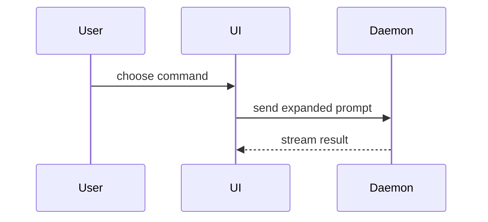

Make a plan for the proposed change. Keep it concise and focused on the key points. If you find edge cases, note them explicitly as out-of-scope. If you identify changes that could be done to improve the design or implementation of the change, include them in the plan but under out-of-scope. This way the user can decide whether to pursue them separately. Verify all assumptions and constraints against the code, documentation, web search etc. Never assume anything without evidence. If something needs investigation, do it before writing the plan, the finished plan should never contain tasks that require further investigation.

## Tonality

Write so a tired engineer understands on the first read.

- Cut every word that does no work.
- Use the short, everyday word: "use", not "utilize".
- When a rule makes a sentence worse, fix the sentence another way or leave it alone.
- Write the real symbol, file, flag, or command name, not a synonym or a description of it.
- Don't invent jargon. Use the words a developer would say out loud. Say what a named pattern means the first time.
- Skip all preambles and keep prose brief, simply and concisely, like one human talking to another.

Use the user's domain language from `GLOSSARY.md` if it exists in the workspace. If it does not exist or a term is not defined there, use the terms the user has used in the conversation and do not invent new names.

## Output

Choose the output from the caller's instructions and the active session mode:

1. **Workflow or subagent:** Return the complete Markdown plan as the result so the caller can pass it to the next step. If the caller requires structured output, put the complete plan in its designated field and follow its schema. A summary or file path alone is not the plan. Create a file only if requested by the caller.
2. **Explicit output request:** If the user asks for a file, save it using the file rules below. If the user asks for text, return the complete Markdown plan.
3. **Plan mode:** Use the session's native plan presentation and approval flow when available. Supply the complete plan through the mechanism provided by the runtime; otherwise return it as the final response. This skill does not switch session modes or require a separate artifact.
4. **Other interactive sessions:** Save the plan using the file rules below.

### File output

- Use the user's path when supplied; otherwise save `plan-<short-kebab-topic>.md` in the session's artifacts folder (the session's `files/` folder), outside the repository.
- Update an existing file only when it is the same plan; otherwise pick a new name.
- Verify the file was saved, then open it in an editor canvas when available.
- Reply with a link to the file and at most three lines on the key decisions, rather than repeating the plan.
- If file output is unavailable or fails, report the limitation and return the complete plan as text.

Producing or saving a plan does not approve its implementation.

## Template

Use this template for writing the plan:

```markdown
## Summary

<diagram, diff-sketch, or tree>

## Evidence

- **Before:** <screenshot/output/failing test run>
  **After:** <screenshot/output/passing test run>

## Test Cases

1. <name first test>
  - <description of the first test case>
2. <name second test>
  - <description of the second test case>

## Out-of-Scope

- <list any specific items that are out of scope for this plan>

**Edge Cases:** <describe any edge cases that are out of scope for this plan>

## Merge Danger

**Door:** <one-way or two-way>

<optional: description>

**Blast Radius:** <one-word description>

<optional: potential ramifications of merge>
```

## Sections

The listed sections isn't comprehensive, more may be added as needed.

### Summary

Pick the two smallest views that make the key point clear, one high-level and one low-level. Always include both when possible. Always use `diff` to show the intended changes and the surrounding shape that already exists. Match the diff shape to the topic.

- Show logic or an algorithm as pseudocode:

```text
on(save)
  if content is unchanged
    return cached result
  write new content
  return fresh result
```

- Show runtime control flow as a call tree:

```text
submitForm
  createSession
    persistPrompt
    launchAgent
  navigateToSession
```

- Show UI structure as a component tree, including state and module boundaries that matter:

```text
<SessionPage> (apps/example/src/routes/session.tsx)
  useSessionEvents()
  <SessionToolbar>
    <RunSkillButton> (packages/ui)
```

- Show file responsibility or a broad refactor as a shallow file tree:

```text
src/
├── commands/       # parses user actions
├── sessions/       # owns session state
└── transport/      # sends API requests
```

- Show component interaction, control flow, or data flow with Mermaid:



For a component change:

```diff
 <SessionPage>
   useSessionEvents()
   <SessionToolbar>
+    <RunSkillButton />
   <SessionTimeline>
+    <SkillResultCard />
```

For a file-layout change:

```diff
 src/
 ├── commands/
+│   └── show-me.ts       # expands the slash command
 ├── sessions/
-└── transport.ts
+└── transport/
+    ├── client.ts
+    └── stream.ts
```

For a call-tree or call-stack change:

```diff
 submitForm
   createSession
     persistPrompt
+    expandSkillMention
     launchAgent
-  navigateToSession
+  navigateToSession
+    subscribeToEvents
```

For a state or control-flow change:

```diff
 on(save)
-  write content
+  if content is unchanged
+    return cached result
+  write new content
+  invalidate cache
```

- Show the whole block when most of it is new, when omitted context would hide ownership or order, or when the user needs a copyable target shape:

```ts
function expandSkill(command: string): string {
  const skillName = command.slice(1);
  return `use the ${skillName} skill`;
}
```

#### Guidance

Place each visual next to the short text it supports. Keep only the calls, files, props, states, and boundaries needed to answer the user's current question or the options to resolve the current discussion point.

You may use one of these, you may use several, it is unlikely you will use all of them. Use your judgement and don't overwhelm the user.

Always include both high-level and low-level views when possible.

### Evidence

Concrete evidence that the change will work. Show a before and after.

### Test Cases

Describe tests that will verify the expected behavior of the change.

### Out-of-Scope

Describe any items, scenarios, or edge cases that are explicitly out of scope for this plan.

### Merge Danger

Describe whether it's a one-way or two-way door. You can walk back through two-way doors, but not one-way doors. A change that is cheap to roll back is lower risk. Changes that involve destructive actions or hard-to-reverse decisions are one-way doors.

The blast radius is the potential impact or scope of the changes introduced by this plan. Consider all possibilities. Examples are layout shift, breakages for consumers, mobile responsiveness, etc.